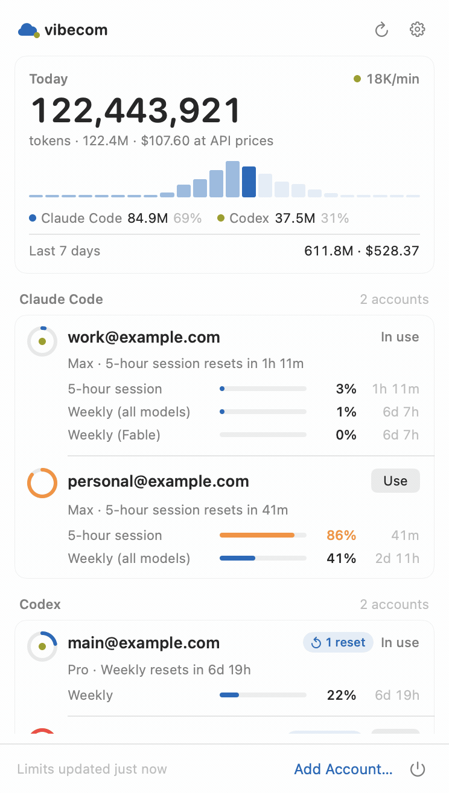
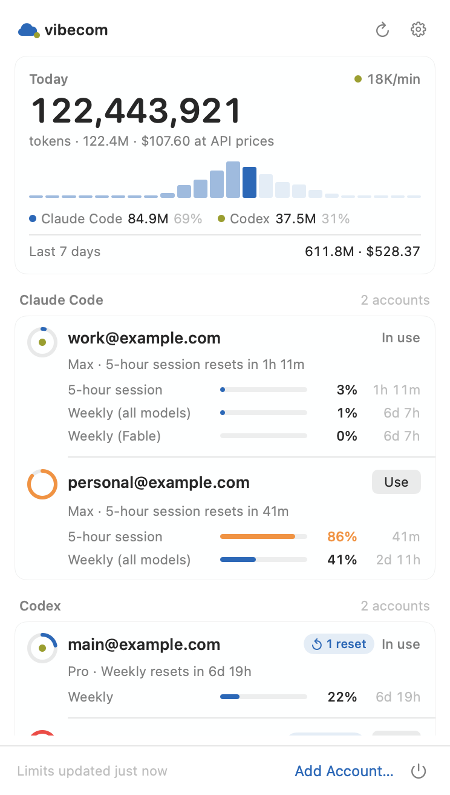
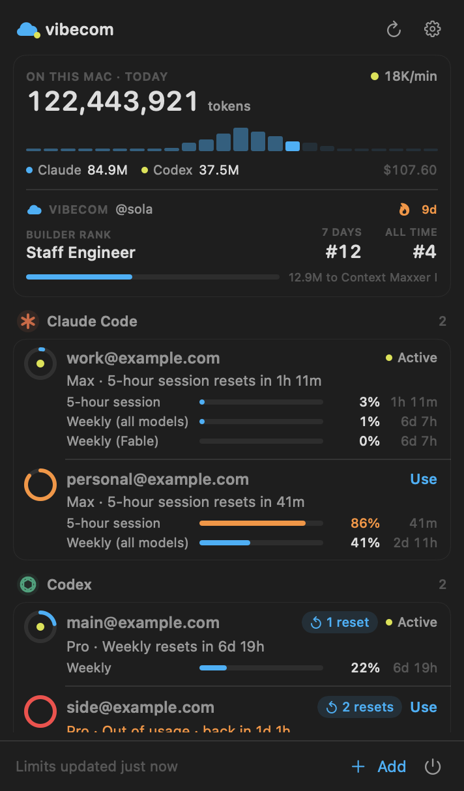
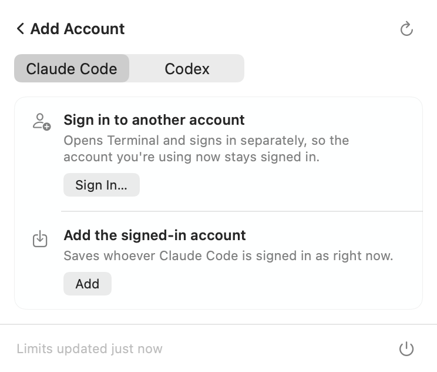

<div align="center">


# vibecom bar

### All your Claude Code and Codex accounts. Right in the menu bar.

See usage. Follow resets. Switch accounts when you choose.

[](https://github.com/DugboTek/vibecom-bar/actions/workflows/ci.yml)
[](https://github.com/DugboTek/vibecom-bar/releases/latest)
[](https://github.com/DugboTek/vibecom-bar/stargazers)
[](LICENSE)

[Website](https://vibecom.build/bar) · [Get started](docs/getting-started.md) · [Security](docs/security-model.md) · [Help](docs/troubleshooting.md)

</div>

---

<p align="center">
  <a href="https://vibecom.build/bar"></a>
</p>

## One place for every account

Vibecom Bar brings Claude Code and Codex together in a native Mac app. Your
accounts, usage windows, reset times, and local token activity are always one
click away.

No tabs to keep open. No account spreadsheets. No wondering which login your
next session will use.

### See what is available

View every saved account and its current limits. The account closest to a
limit rises to the top, with its reset time shown beside it.

### Switch when it makes sense

Choose the account you want Claude Code or Codex to use next. Nothing changes
until you ask. Or turn on Auto Swap to move at 99% to the available account
whose next reset is soonest.

Live Handoff is optional. When enabled, sessions launched afterward can move to
the selected account between turns and continue the same conversation. It works
in Terminal, tmux, and Xirp when they launch through the installed Vibecom
command. Sessions that were already running when you enabled it stay untouched.

### Serve another user on the same Mac

A second macOS user that never signs in to the desktop, such as a `compass`
service account, can draw on the same pool of Claude accounts and follow every
switch. Turn on **Settings → Serve Another User**, then give each Claude account
a **Compass token**: run `claude setup-token` signed in as that account and paste
the token into **Set Compass Token…** in the account's right-click menu.

Whenever the active Claude account changes, by **Use** or by Auto Swap, and at
launch, vibecom bar writes that account's Compass token to
`/Users/Shared/compass-auth/claude.token` (you can change the path). The other
user reads it into `CLAUDE_CODE_OAUTH_TOKEN`. If the active account has no
Compass token, nothing is active, or the setting is off, the file is removed
and the other user pauses rather than running on the wrong account.

Only the long-lived setup-token is ever shared. The other user never receives
a refresh token or Claude Code's own login, so neither side can sign the other
out. Usage tracking keeps using each account's normal login.

One-time setup, as an administrator (replace `you` with the menu bar user):

```bash
sudo dseditgroup -o create compassauth
sudo dseditgroup -o edit -a you -t user compassauth
sudo dseditgroup -o edit -a compass -t user compassauth
sudo mkdir -p /Users/Shared/compass-auth
sudo chown you:compassauth /Users/Shared/compass-auth
sudo chmod 750 /Users/Shared/compass-auth
```

The token file is written as mode 640 and takes the folder's group, so only
you and members of `compassauth` can read it. vibecom bar never creates users,
groups, or permissions itself. If the folder is missing, owned by someone else,
writable by everyone, or not writable, the setting shows why and nothing is
written. On the other user's side, read the file fresh for each session:

```bash
export CLAUDE_CODE_OAUTH_TOKEN="$(cat /Users/Shared/compass-auth/claude.token)" && claude
```

### Follow your work as it happens

See today's tokens, your live token rate, and estimated API value across both
tools. If you use Vibecom, your builder rank, weekly standing, all-time
standing, streak, and progress to the next rank appear alongside them.

## Install

Vibecom Bar requires macOS 14 or newer and Claude Code, Codex, or both.
Paste this into Terminal:

```bash
curl -fsSL https://vibecom.build/bar/install.sh | bash
```

It downloads the latest [release](https://github.com/DugboTek/vibecom-bar/releases/latest),
checks its SHA-256 and its Developer ID signature (team `N9S23BFMU4`),
installs it in `/Applications`, and opens it. You do not need Xcode. Run the
same command again to update. The script is
[`scripts/install.sh`](scripts/install.sh) if you want to read it first.

Then open the cloud in your menu bar and choose **Add account**.

### Build from source

Building needs **Xcode 16 or newer**, not just the Command Line Tools: SwiftUI's
macros ship only inside Xcode. The build script finds an installed Xcode even
when `xcode-select` points at the Command Line Tools.

```bash
git clone https://github.com/DugboTek/vibecom-bar.git
cd vibecom-bar
./scripts/build-app.sh
open "Vibecom Bar.app"
```

[Read the getting-started guide →](docs/getting-started.md)

## Private by design

Your credentials stay in macOS Keychain. Your conversations, responses, and
source code stay on your Mac.

Vibecom Bar reads usage from the providers and token totals from the local
files their CLIs already create. It does not upload your coding activity to
vibecom.build. Accounts change only when you choose **Use**, or when you turn
on **Auto Swap** and the active account reaches 99%.

- Credentials are protected by macOS Keychain.
- Saved account details remain local to your Mac.
- Message content is never included in token totals.
- Claude Code remains in control of its active login.

[See exactly how credentials are handled →](docs/security-model.md)

## Looks at home on your Mac

| Light | Dark |
|---|---|
|  |  |

<p align="center"></p>

## Built in the open

Vibecom Bar is written in Swift and licensed under MIT. The full source,
security model, tests, and release process are here for anyone to inspect.

```bash
swift test
swift build
```

The offline test suite covers account storage, switching, usage, token totals,
alerts, and provider responses without touching your real logins.

| Learn more | |
|---|---|
| [Getting started](docs/getting-started.md) | Add your first Claude or Codex account |
| [Security](docs/security-model.md) | Learn where credentials and account details live |
| [Troubleshooting](docs/troubleshooting.md) | Get help with login, usage, and menu behavior |
| [Contributing](CONTRIBUTING.md) | Build the app and propose changes |
| [Support](SUPPORT.md) | Find the right place to ask for help |

---

<div align="center">

Part of [vibecom](https://vibecom.build), the community for AI builders.

[MIT](LICENSE) © 2026 DugboTek

</div>
